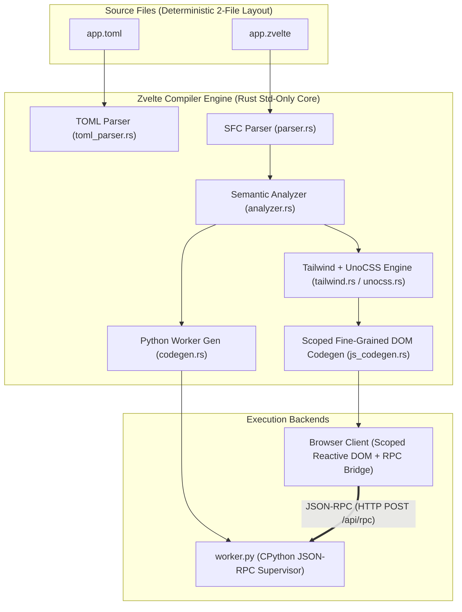

# Zvelte

> **A Python Reactive Web Framework Powered by Rust.**  
> Author full-stack, fine-grained reactive web applications using Python server logic and Svelte-like frontend syntax in a single `.zvelte` component, backed by an ultra-fast, zero-dependency Rust engine.

[](https://www.rust-lang.org/)
[](https://www.python.org/)
[](https://unocss.dev/)
[](LICENSE)
[](https://github.com/babar-xagi/Zvelte/releases/tag/v0.0.9)

---

## 🌟 Highlights

- 🐍 **Developed for Python:** Write Python backend functions, AI pipelines, database queries, and data processing directly inside your component (`<script lang="python">`).
- 🎨 **Full Built-In Tailwind CSS & UnoCSS (Zero Node.js):** Use standard Tailwind utility classes OR full UnoCSS workflows — **Attributify Mode** (`<div flex items-center bg="slate-900 hover:slate-800" p="x-4 y-2">`), **Nested Variant Groups** (`hover:(bg-sky-500 text-white)`), **`[unocss.shortcuts]`** in `app.toml`, preset-uno shorthands (`c-*`, `op-*`, `fw-*`, `rd*`, `pa-*`, `lt-md:*`, `hocus:*`, `p-6!`), and CSS `--at-apply:` / `@screen` / `theme()` — compiled in milliseconds purely by Rust with zero `npm` or `node_modules`.
- ⚡ **Powered by Rust:** The compiler, parser, bundler, and development server are written 100% in Rust (`std`-only) for ~3–5ms builds, ~699 KB release binaries, and memory safety.
- 🎯 **Svelte-Style Fine-Grained Reactivity:** Zero Virtual DOM overhead. Supports `$:` reactive derived declarations, client `<script>` state compilation, `on:event|preventDefault` / `onclick` / `click` handlers, `{#if}` / `{:else if}`, `{#each items as item, idx}`, and two-way bindings (`bind:value` / `bind:checked`) with hierarchical scope cleanup (`__clear_scope`).
- 🐍 **Async Python RPC Bridge:** Call `def` and `async def` Python functions directly inside reactive markup (`{fn(...)}`) or events (`click={res = py_fn()}`), automatically awaited in client JS and executed inside CPython `worker.py`.
- 🔥 **Live Hot Reload Dev Server:** Built-in HTTP server (`zvelte dev`) with automatic port fallback, `hot_reload` file watching for `app.toml` and `.zvelte`, and supervised CPython worker restarts.
- 📁 **Deterministic Two-File Scaffold:** `zvelte new my-app` generates **strictly** `app.toml` and `app.zvelte`. Zero configuration noise, no `package.json`, no webpack, no `node_modules`.
- 🛡️ **Secure by Design:** Only safe JSON-compatible literals auto-sync to client reactive state; Python environment lookups (`os.getenv(...)`), API keys, and server secrets remain strictly inside the Python worker process.

---

## 🤖 Live Showcase: AI Chatbot in a Single Component

Build AI-native web apps with Python and Google Gemini / OpenAI inside a single `.zvelte` component — zero npm, zero pip dependencies required, and zero API key leakage:

```html
<!-- app.zvelte -->
<script lang="python">
import os, json, urllib.request

GEMINI_KEY = os.getenv("GEMINI_API_KEY", "")

def ask_ai(prompt):
    url = f"https://generativelanguage.googleapis.com/v1beta/models/gemini-2.5-flash:generateContent?key={GEMINI_KEY}"
    req = urllib.request.Request(
        url,
        data=json.dumps({"contents":[{"parts":[{"text": prompt}]}]}).encode("utf-8"),
        headers={"Content-Type": "application/json"}
    )
    with urllib.request.urlopen(req, timeout=15) as resp:
        return json.loads(resp.read().decode("utf-8"))["candidates"][0]["content"]["parts"][0]["text"]
</script>

<state>
user_prompt: string = ""
ai_reply: string = ""
is_loading: bool = false
</state>

<main>
    <input type="text" bind:value={user_prompt} placeholder="Ask Gemini anything..." />
    <button click={
        is_loading = true;
        const p = user_prompt;
        user_prompt = "";
        ask_ai(p).then(res => { ai_reply = res; is_loading = false; update(); });
    }>Send Prompt</button>

    {#if is_loading}
        <p>Thinking & streaming from Python server...</p>
    {/if}
    {#if ai_reply}
        <div class="bubble">{ai_reply}</div>
    {/if}
</main>
```

> 🛡️ **Zero API Key Leakage:** Server expressions like `GEMINI_KEY = os.getenv("GEMINI_API_KEY", "")` are executed exclusively inside the isolated CPython `worker.py` process and never emitted into browser `app.js`. Run it with `cd examples/04-ai-chatbot && zvelte dev`!

---

## 📚 Documentation & Guides

- 🏗️ **[Architecture & Internal Design](docs/ARCHITECTURE.md):** Rust compiler pipeline, scoped reactivity, and Python IPC runtime.
- 🚀 **[Getting Started Guide](docs/GETTING_STARTED.md):** Installing Rust + Python, scaffolding, dev server, and production builds.
- 🪟 **[Windows Setup Guide](docs/WINDOWS_SETUP.md):** Step-by-step PowerShell setup and CRLF/Winsock compatibility.
- 📄 **[Component Format Reference](docs/COMPONENT_FORMAT.md):** `.zvelte` scripts, comments, `<state>`, `{#if}`, `{#each}`, `bind:value`, and styles.
- ⚙️ **[Configuration Reference](docs/CONFIGURATION.md):** Complete `app.toml` reference.
- 🛠️ **[CLI Reference Manual](docs/CLI_REFERENCE.md):** `new`, `check`, `build`, `dev`, and `clean`.
- ⚡ **[Benchmarks](docs/BENCHMARKS.md)** & **[Zig vs Rust Comparison](comparison.md):** Measured timings and binary sizes.
- 🗺️ **[Roadmap](ROADMAP.md)** & **[Changelog](CHANGELOG.md):** What's done, what's remaining (`v0.1.0+`), and release notes.

---

## 💡 Code Examples

Browse working example applications in [`examples/`](examples/):

- ⚡ **[01-counter](examples/01-counter/):** Pure reactive client counter with increment, decrement, and reset.
- 📝 **[02-todo-app](examples/02-todo-app/):** Task manager with `{#each}` lists, `{#if}` banners, and `bind:value` form bindings.
- 🐍 **[03-python-api](examples/03-python-api/):** Python server functions (`datetime`, `math`, `platform`) invoked over JSON-RPC.
- 🤖 **[04-ai-chatbot](examples/04-ai-chatbot/):** Full AI chatbot supporting Google Gemini & OpenAI GPT-4o with zero pip dependencies.
- 🎨 **[05-tailwind-dashboard](examples/05-tailwind-dashboard/):** Responsive Tailwind CSS + dark mode dashboard with `@apply`, gradients, dynamic classes, and live Python analytics RPC.
- ⚡ **[06-unocss-showcase](examples/06-unocss-showcase/):** Full UnoCSS playground featuring Attributify Mode, nested variant groups, TOML `[unocss.shortcuts]`, `--at-apply:`, `@screen`, `theme()`, and Python RPC.

---

## 🚀 Quick Start

### Installation

```bash
# 1. Clone the repository
git clone git@github.com:babar-xagi/Zvelte.git
cd Zvelte

# 2. Build optimized release binary via Cargo
cargo build --release

# 3. Copy or link to your PATH
cp target/release/zvelte ~/.local/bin/

# 4. Verify
zvelte --version
```

### Create Your First App

```bash
# 1. Create a project (strictly produces app.toml + app.zvelte)
zvelte new my-app
cd my-app

# 2. Start the local development server (with automatic port fallback & hot reload)
zvelte dev
# Open http://127.0.0.1:3000/

# 3. Compile for production
zvelte build
# Emits optimized dist/index.html, dist/app.js, and dist/worker.py
```

---

## 📐 Component Anatomy (`app.zvelte`)

Declare Python server functions and client reactive state inside `<script>`, and bind them directly in your markup:

```html
<!-- app.zvelte -->
<script lang="python">
name = "Babar"
count = 0

def greeting(user):
    return f"Hello {user}! Greetings from Python server."

def calculate_square(n):
    return int(n) ** 2
</script>

<main>
    <h1>Hello {name}</h1>
    <p>{greeting(name)}</p>

    <div class="card">
        <button click={count++}>
            Clicked {count} times
        </button>
        <button click={count = 0}>
            Reset
        </button>
    </div>

    <div class="card">
        <p>Square of {count} is: <strong>{calculate_square(count)}</strong></p>
    </div>
</main>

<style>
main {
    font-family: system-ui, sans-serif;
    max-width: 36rem;
    margin: 4rem auto;
    text-align: center;
    padding: 2.5rem;
    background: #ffffff;
    border-radius: 12px;
}
</style>
```

---

## 🏗️ Architecture Diagram



---

## 🧪 Testing

Run the full unit and integration test suite:

```bash
cargo test
```

---

## 📄 License

This project is licensed under the [MIT License](LICENSE).
