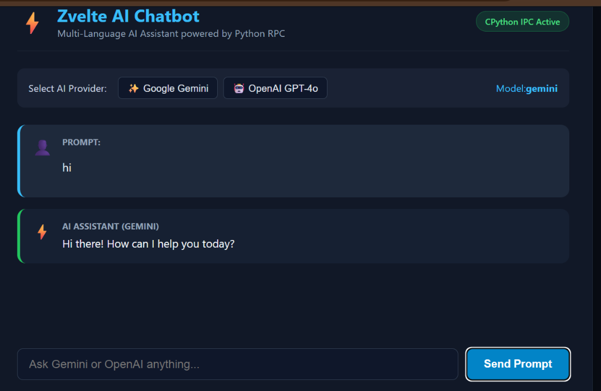
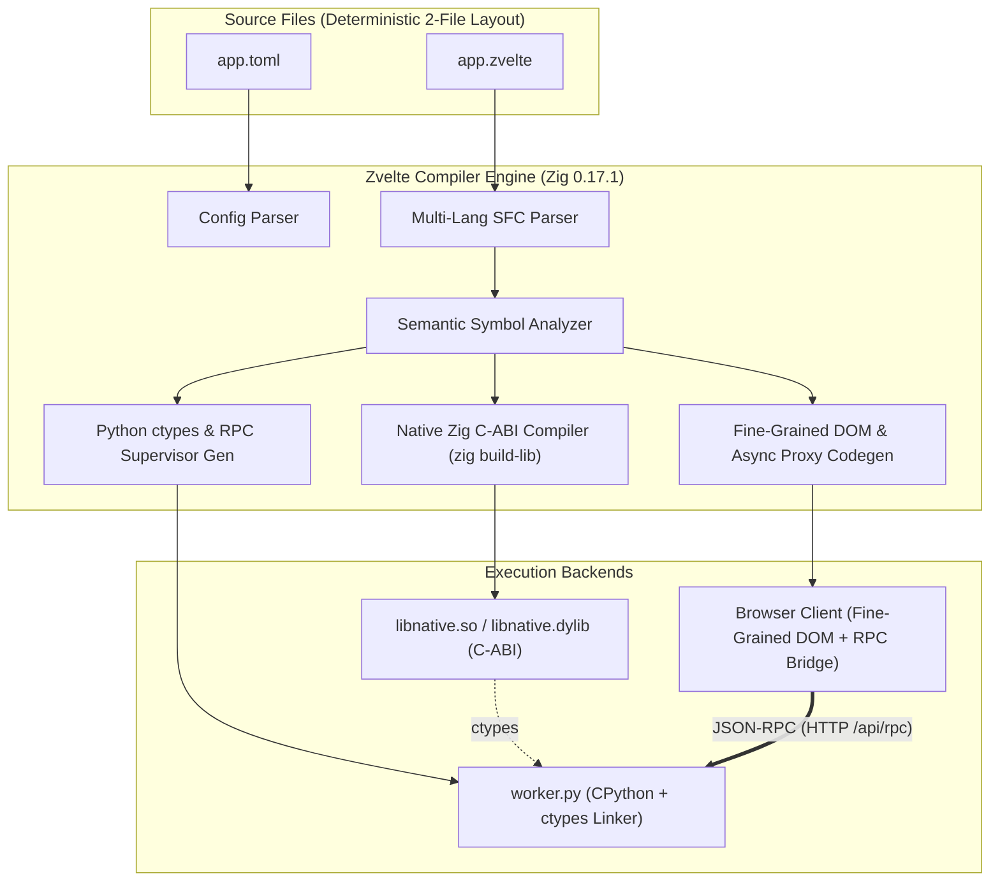

# Zvelte

> **A Zig-powered, multi-language reactive web framework with Python and Zig source blocks, a shared component format, and JavaScript/WebAssembly execution backends.**

[](https://ziglang.org/)
[](LICENSE)
[](https://github.com/babar-xagi/Zvelte/releases/tag/v0.0.4)

---

## 🌟 Highlights

- ⚡ **Deterministic Two-File Scaffold:** `zvelte new my-app` generates **strictly** `app.toml` and `app.zvelte`. Zero configuration noise, no `package.json`, no `build.zig`, no lockfiles.
- 🎯 **Fine-Grained Reactivity:** Zero Virtual DOM overhead. Reactive state bindings directly update affected DOM text cells and attributes.
- 🐍 **Multi-Language Architecture:** Author Python server routes, native Zig acceleration routines, and client UI state inside a single component.
- 🚀 **Blazing Native Performance:** Native Zig 0.17.1 compiler with sub-10ms build times and sub-millisecond dev server response latency.

---

## 🤖 Live Showcase: AI Chatbot in a Single Component

Build high-performance, AI-native web apps with Python and Google Gemini / OpenAI inside a single `.zvelte` component—with zero npm, zero pip dependencies, and zero API key leakage:

<p align="center">
  
</p>

```html
<!-- app.zvelte -->
<script lang="python" context="server">
import os, json, urllib.request

GEMINI_KEY = os.getenv("GEMINI_API_KEY", "")

def ask_ai(prompt):
    url = f"https://generativelanguage.googleapis.com/v1beta/models/gemini-2.5-flash:generateContent?key={GEMINI_KEY}"
    req = urllib.request.Request(url, data=json.dumps({"contents":[{"parts":[{"text": prompt}]}]}).encode("utf-8"), headers={"Content-Type": "application/json"})
    with urllib.request.urlopen(req, timeout=15) as resp:
        return json.loads(resp.read().decode("utf-8"))["candidates"][0]["content"]["parts"][0]["text"]
</script>

<state>
user_prompt: string = ""
ai_reply: string = ""
is_loading: bool = false
</state>

<main>
    <input type="text" bind:value={user_prompt} placeholder="Ask Gemini anything..." />
    <button click={
        is_loading = true;
        const p = user_prompt;
        user_prompt = "";
        ask_ai(p).then(res => { ai_reply = res; is_loading = false; update(); });
    }>Send Prompt</button>

    {#if is_loading}
        <p>Thinking & streaming from Python server...</p>
    {/if}
    {#if ai_reply}
        <div class="bubble">{ai_reply}</div>
    {/if}
</main>
```

> 🛡️ **Zero API Key Leakage:** `GEMINI_API_KEY` stays strictly in the isolated CPython worker process. It is never bundled or exposed in browser JavaScript assets. Run it with `cd examples/04-ai-chatbot && zvelte dev`!

---

## 📚 Documentation & Guides

- 🏗️ **[Architecture & Design Deep Dive](docs/ARCHITECTURE.md):** Complete internal pipeline and dataflow architecture.
- 🚀 **[Getting Started Guide](docs/GETTING_STARTED.md):** Step-by-step setup, installation, and first app tutorial.
- 📄 **[Component Format Reference](docs/COMPONENT_FORMAT.md):** Detailed guide to `.zvelte` multi-language script blocks, `<state>`, markup, and styles.
- ⚙️ **[Configuration Reference](docs/CONFIGURATION.md):** Complete `app.toml` options and validation rules.
- 🛠️ **[CLI Reference Manual](docs/CLI_REFERENCE.md):** Detailed manual for `new`, `dev`, `check`, `build`, and `clean`.
- ⚡ **[Empirical Benchmarks](docs/BENCHMARKS.md):** Latency timings, bundle sizes, and performance comparisons.
- 🗺️ **[Roadmap](ROADMAP.md):** Phase-by-phase implementation plan and upcoming milestones.
- 📜 **[Changelog](CHANGELOG.md):** Release history and version notes.

---

## 💡 Code Examples

Browse working example applications in the [`examples/`](examples/) directory:

- ⚡ **[01-counter](examples/01-counter/):** Pure reactive client counter with increment, decrement, and reset.
- 📝 **[02-todo-app](examples/02-todo-app/):** Task manager illustrating multiple state variables and card layout.
- 🐍 **[03-hybrid-python-zig](examples/03-hybrid-python-zig/):** Multi-language hybrid app with Python server logic, Zig native functions, and WASM blocks.
- 🤖 **[04-ai-chatbot](examples/04-ai-chatbot/):** Full AI chatbot supporting Google Gemini 2.0 & OpenAI GPT-4o with server-side API keys and zero pip dependencies.

---

## 🚀 Quick Start

### Installation

```bash
# 1. Clone the compiler
git clone git@github.com:babar-xagi/Zvelte.git
cd Zvelte

# 2. Build and install to local bin
zig build -Doptimize=ReleaseFast
cp zig-out/bin/zvelte ~/.local/bin/

# 3. Verify
zvelte --version
```

### Create Your First App

```bash
# 1. Create a project (strictly produces app.toml + app.zvelte)
zvelte new my-app
cd my-app

# 2. Start the local development server
zvelte dev
# Open http://127.0.0.1:3000/

# 3. Compile for production
zvelte build
# Emits optimized dist/index.html and dist/app.js
```

---

## 📐 Component Anatomy (`app.zvelte`)

```html
<script lang="python" context="server">
from datetime import datetime

name = "Babbar"

def greeting():
    return f"Hello {name}"
</script>

<script lang="zig" context="native">
pub export fn zvelte_double(value: i32) callconv(.c) i32 {
    return value * 2;
}
</script>

<script lang="zig" context="wasm">
pub export fn zvelte_square(value: i32) callconv(.c) i32 {
    return value * value;
}
</script>

<state>
count: i32 = 0
</state>

<main>
    <h1>{greeting()}</h1>
    <h2>Count: {count}</h2>

    <button click={count++}>
        Increment
    </button>

    <button click={count = 0}>
        Reset
    </button>
</main>

<style>
main {
    font-family: system-ui, sans-serif;
    max-width: 42rem;
    margin: 3rem auto;
    text-align: center;
}
button {
    margin: 0.5rem;
    padding: 0.5rem 1rem;
    border-radius: 6px;
    cursor: pointer;
}
</style>
```

---

## 🏗️ Architecture Diagram



---

## 🧪 Testing

Run the full suite of unit and integration tests:

```bash
zig build test
```

---

## 📄 License

This project is licensed under the [MIT License](LICENSE).
