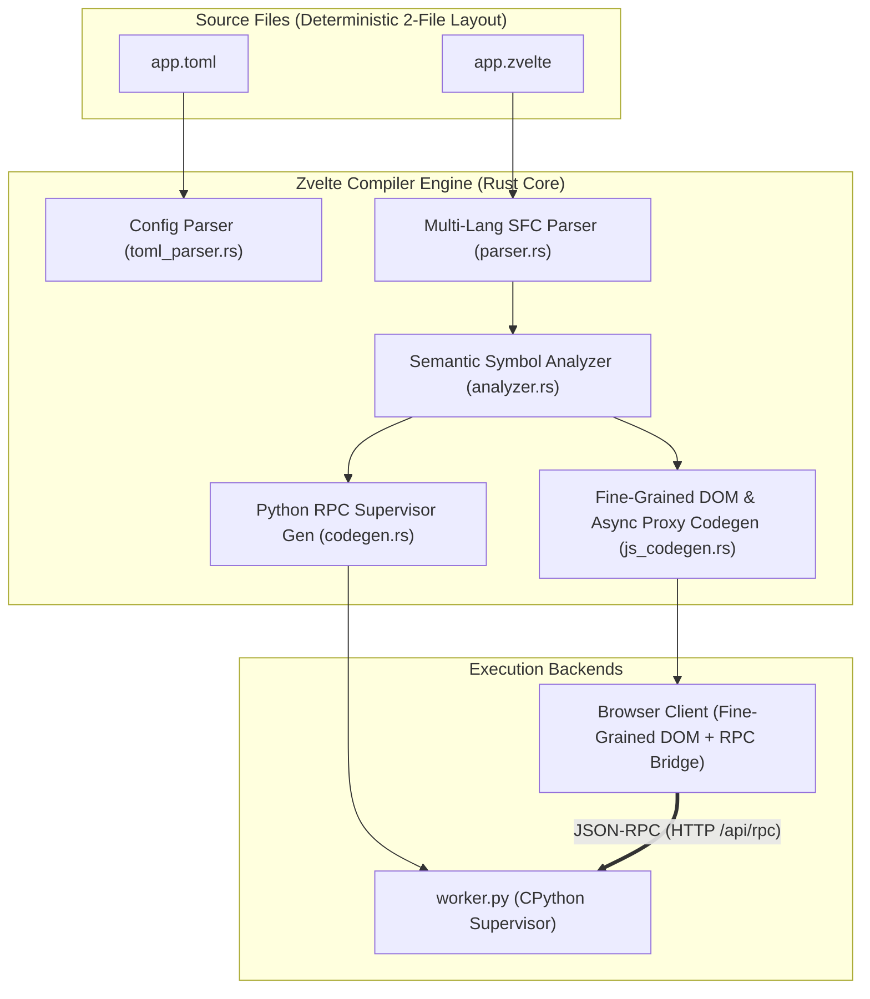

# Zvelte

> **A Python Reactive Web Framework Powered by Rust.**  
> Author full-stack, fine-grained reactive web applications using Python server logic and Svelte-like frontend syntax in a single `.zvelte` component, backed by an ultra-fast, zero-dependency Rust engine.

[](https://www.rust-lang.org/)
[](https://www.python.org/)
[](LICENSE)
[](https://github.com/babar-xagi/Zvelte/releases/tag/v0.0.5)

---

## 🌟 Highlights

- 🐍 **Developed for Python:** Write Python backend functions, AI pipelines, database queries, and data processing directly inside your component (`<script lang="python">`).
- ⚡ **Powered by Rust:** The compiler, parser, bundler, and development server are written 100% in Rust (`std`-only) for sub-millisecond execution, sub-500 KB binary footprint, and rock-solid memory safety.
- 🎯 **Fine-Grained Reactivity:** Zero Virtual DOM overhead. Reactive state bindings directly update affected DOM text cells and attributes, just like Svelte.
- 📁 **Deterministic Two-File Scaffold:** `zvelte new my-app` generates **strictly** `app.toml` and `app.zvelte`. Zero configuration noise, no `package.json`, no webpack, no node_modules.
- 🛡️ **Secure by Design:** Server-side API keys, database credentials, and secret logic stay strictly inside the Python server process and are never bundled into client-side JavaScript.

---

## 🤖 Live Showcase: AI Chatbot in a Single Component

Build high-performance, AI-native web apps with Python and Google Gemini / OpenAI inside a single `.zvelte` component—with zero npm, zero pip dependencies, and zero API key leakage:

```html
<!-- app.zvelte -->
<script lang="python">
import os, json, urllib.request

GEMINI_KEY = os.getenv("GEMINI_API_KEY", "")

def ask_ai(prompt):
    url = f"https://generativelanguage.googleapis.com/v1beta/models/gemini-2.5-flash:generateContent?key={GEMINI_KEY}"
    req = urllib.request.Request(
        url,
        data=json.dumps({"contents":[{"parts":[{"text": prompt}]}]}).encode("utf-8"),
        headers={"Content-Type": "application/json"}
    )
    with urllib.request.urlopen(req, timeout=15) as resp:
        return json.loads(resp.read().decode("utf-8"))["candidates"][0]["content"]["parts"][0]["text"]
</script>

<state>
user_prompt: string = ""
ai_reply: string = ""
is_loading: bool = false
</state>

<main>
    <input type="text" bind:value={user_prompt} placeholder="Ask Gemini anything..." />
    <button click={
        is_loading = true;
        const p = user_prompt;
        user_prompt = "";
        ask_ai(p).then(res => { ai_reply = res; is_loading = false; update(); });
    }>Send Prompt</button>

    {#if is_loading}
        <p>Thinking & streaming from Python server...</p>
    {/if}
    {#if ai_reply}
        <div class="bubble">{ai_reply}</div>
    {/if}
</main>
```

> 🛡️ **Zero API Key Leakage:** `GEMINI_API_KEY` stays strictly in the isolated CPython worker process. It is never bundled or exposed in browser JavaScript assets. Run it with `cd examples/04-ai-chatbot && zvelte dev`!

---

## 💡 Code Examples

Browse working example applications in the [`examples/`](examples/) directory:

- ⚡ **[01-counter](examples/01-counter/):** Pure reactive client counter with increment, decrement, and reset.
- 📝 **[02-todo-app](examples/02-todo-app/):** Task manager illustrating multiple state variables, two-way bindings, and loops.
- 🐍 **[03-python-api](examples/03-python-api/):** Python server integration for calculations, platform info, and data formatting.
- 🤖 **[04-ai-chatbot](examples/04-ai-chatbot/):** Full AI chatbot supporting Google Gemini & OpenAI GPT-4o with server-side API keys and zero pip dependencies.

---

## 🚀 Quick Start

### Installation

```bash
# 1. Clone the repository
git clone git@github.com:babar-xagi/Zvelte.git
cd Zvelte

# 2. Build optimized release binary via Cargo
cargo build --release

# 3. Copy or link to your PATH
cp target/release/zvelte ~/.local/bin/

# 4. Verify
zvelte --version
```

### Create Your First App

```bash
# 1. Create a project (strictly produces app.toml + app.zvelte)
zvelte new my-app
cd my-app

# 2. Start the local development server
zvelte dev
# Open http://127.0.0.1:3000/

# 3. Compile for production
zvelte build
# Emits optimized dist/index.html, dist/app.js, and dist/worker.py
```

---

## 📐 Component Anatomy (`app.zvelte`)

Declare Python server functions and client reactive state inside `<script>`, and bind them directly in your markup with Svelte-style ergonomics:

```html
<script lang="python">
name = "Babar"
count = 0

def greeting(user):
    return f"Hello {user}! Greetings from Python server."

def calculate_square(n):
    return int(n) ** 2
</script>

<main>
    <h1>Hello {name}</h1>
    <p>{greeting(name)}</p>

    <div class="card">
        <button click={count++}>
            Clicked {count} times
        </button>
        <button click={count = 0}>
            Reset
        </button>
    </div>

    <div class="card">
        <p>Square of {count} is: <strong>{calculate_square(count)}</strong></p>
    </div>
</main>

<style>
main {
    font-family: system-ui, sans-serif;
    max-width: 36rem;
    margin: 4rem auto;
    text-align: center;
    padding: 2.5rem;
    background: #ffffff;
    border-radius: 12px;
}
h1 {
    color: #1e293b;
    margin-bottom: 0.5rem;
}
p {
    color: #64748b;
    margin-bottom: 1.5rem;
}
.card {
    background: #f8fafc;
    border: 1px solid #e2e8f0;
    border-radius: 8px;
    padding: 1.5rem;
    margin-bottom: 1rem;
}
button {
    background: #0284c7;
    color: white;
    border: none;
    padding: 0.625rem 1.25rem;
    border-radius: 6px;
    font-weight: 600;
    cursor: pointer;
    margin: 0 0.25rem;
    transition: background 0.15s;
}
button:hover {
    background: #0369a1;
}
</style>
```

---

## 🏗️ Architecture Diagram



---

## 🧪 Testing

Run the full suite of unit and integration tests:

```bash
cargo test
```

---

## 📄 License

This project is licensed under the [MIT License](LICENSE).
