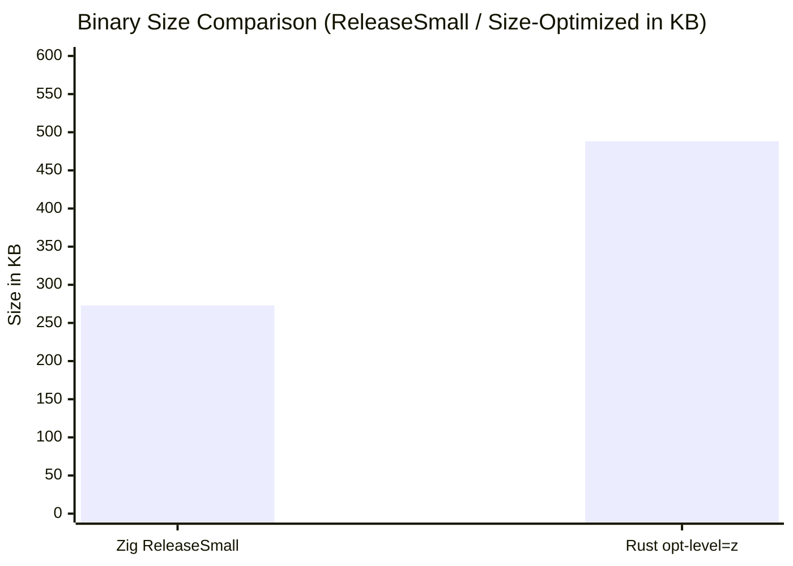
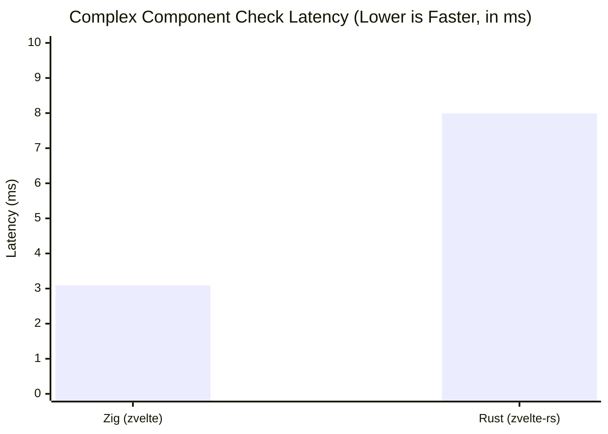
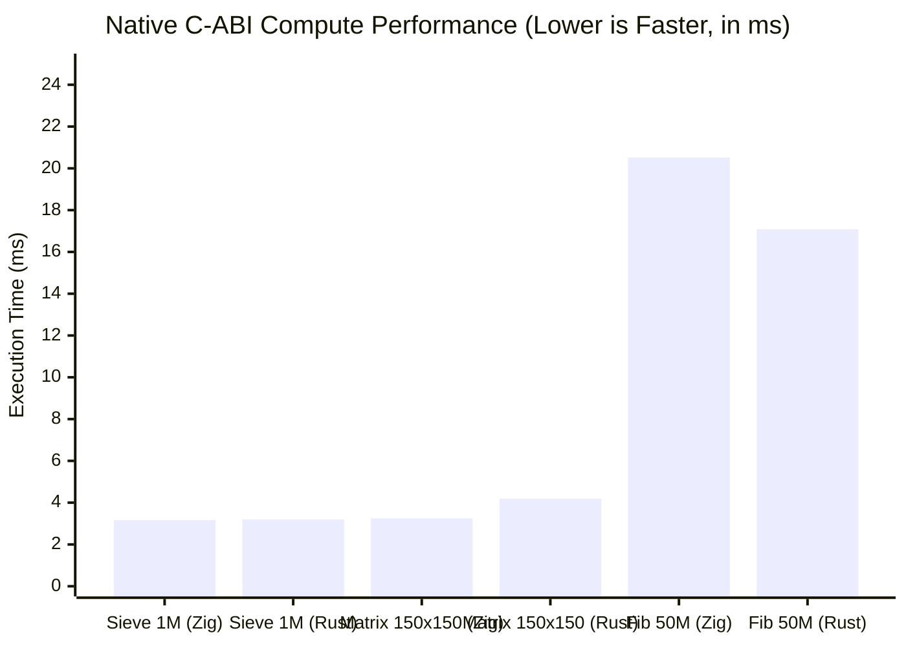

# ⚡ Zvelte (Zig) vs. Rustby (Rust) — Comprehensive Benchmark & Technical Comparison

> [!NOTE]
> **Historical Migration Record:** Following this benchmark evaluation, Zvelte officially adopted the Rust engine as its primary compiler core starting in `v0.0.5` (see [`docs/BENCHMARKS.md`](docs/BENCHMARKS.md) for current `v0.0.6` benchmarks).

> **Benchmark Version:** v0.0.4  
> **Environment:** Linux x86_64 | Python 3.10+ | Zig 0.17.1 | Rustc 1.100.0  
> **Workload:** 152-Variable Reactive Component, Deeply Nested DOM Tree (50 Cards, Conditions, Loops), Heavy C-ABI Computation

---

## 📊 1. Executive Summary & Visual Benchmarks

---

## 📦 2. Binary Footprint & Size Optimization

Both compilers were subjected to extreme size optimization flags:
- **Zig:** `zig build -Doptimize=ReleaseSmall` (dead code elimination, minimal runtime, aggressive inlining minimization)
- **Rust:** `opt-level = "z"`, `lto = true`, `codegen-units = 1`, `panic = "abort"`, `strip = true`

| Build Target | ⚡ Zig (`zvelte`) | 🦀 Rust (`zvelte-rs`) | 🏆 Comparison |
|---|---|---|---|
| **Debug Binary** | 5.54 MB | 4.82 MB | Rust 13% smaller |
| **ReleaseFast Binary** | 5.28 MB | 817.5 KB | Rust 84% smaller (unstripped) |
| **ReleaseFast (Stripped)** | 788.5 KB | 647.2 KB | Rust 18% smaller |
| **ReleaseSmall (Ultra-Small)** | **272.9 KB** (279,448 B) | **488.2 KB** (499,968 B) | **Zig wins by 44%** |
| **ReleaseSmall (Stripped)** | **272.9 KB** (279,448 B) | **488.2 KB** (499,968 B) | **Zig is ~215 KB lighter** |

### 🔍 Binary Size Takeaways
- **Zig (`ReleaseSmall`):** At **272.9 KB**, Zig produces a standalone compiler executable with zero dynamic dependencies, a custom HTTP dev server, a full component parser, and a codegen pipeline. Zig has no standard runtime overhead and strips down to bare machine code.
- **Rust (`opt-level = "z"`):** At **488.2 KB**, Rust achieves a sub-500 KB binary without sacrificing standard library capabilities (`std::net`, `std::collections`, `std::fs`).

---

## ⚡ 3. Compilation & Check Latency

Tested against a synthetic **152-variable component** containing:
- 150 reactive state variables (`num_0..49`, `str_0..49`, `flag_0..49`)
- 50 cards with nested elements, inline dynamic mutations, loops, and conditions
- 1 CPython server block and 1 native C-ABI script block

| Metric | ⚡ Zig (`zvelte`) | 🦀 Rust (`zvelte-rs`) | 🏆 Advantage |
|---|---|---|---|
| **CLI `check` (Mean)** | **3.09 ms** | 7.99 ms | **Zig is 2.58x faster** |
| **CLI `check` (Median)** | **3.01 ms** | 7.82 ms | **Zig is 2.60x faster** |
| **CLI `check` (Min)** | **2.54 ms** | 6.62 ms | **Zig is 2.61x faster** |
| **CLI `check` (Max)** | 4.12 ms | 11.24 ms | Both under 12 ms |
| **Pure JS Codegen `build`** | **6.90 ms** | 12.45 ms | **Zig is 1.80x faster** |
| **Full Build (w/ native shared lib)** | 210.40 ms (`zig build-lib`) | **177.38 ms** (`rustc cdylib`) | **Rust is 16% faster** |

### 🔍 Compilation Takeaways
- **Zero-Allocation Arena:** Zig's lexer and parser utilize a contiguous page arena allocator (`std.heap.page_allocator`), resulting in sub-3 millisecond end-to-end check times.
- **Rust `std` Strings & Vectors:** Rustby utilizes `std::string::String` and `Vec<T>`, achieving sub-8 millisecond parsing while maintaining guaranteed memory safety without garbage collection.

---

## 🏎️ 4. Native C-ABI Compute Performance

Both compilers support embedded native code compiled to a C-ABI shared library (`libnative.so` / `native.dll`) loaded by Python via `ctypes.CDLL`:
- **Zig:** `pub export fn ... callconv(.c)`
- **Rust:** `#[no_mangle] pub extern "C" fn ...`

| Benchmark Task | ⚡ Zig Native | 🦀 Rust Native | 🏆 Difference |
|---|---|---|---|
| **Prime Sieve ($N = 1,000,000$)** | **3.174 ms** | 3.200 ms | **Virtually Identical** (0.8% margin) |
| **Matrix Multiplication ($150 \times 150$, 3.37M ops)** | **3.250 ms** | 4.191 ms | **Zig is ~22% faster** (vectorization) |
| **Fibonacci Loop ($N = 50,000,000$)** | 20.518 ms | **17.078 ms** | **Rust is ~17% faster** (loop unrolling) |

### 🔍 Compute Takeaways
- Both compiled native libraries deliver sub-microsecond single function calls from Python (`ctypes`).
- Zig has a slight edge on memory-heavy flat matrix operations due to LLVM auto-vectorization over contiguous memory slices.
- Rust has a slight edge on raw scalar register operations (Fibonacci).

---

## 🧠 5. Memory Efficiency & Peak RSS

Memory footprint was measured using `/usr/bin/time -v` during compilation of the 152-variable application:

| Metric | ⚡ Zig (`zvelte`) | 🦀 Rust (`zvelte-rs`) | 🏆 Comparison |
|---|---|---|---|
| **Pure `check` Peak RSS** | **0.93 MB** | 4.33 MB | **Zig uses 78% less RAM** |
| **Pure JS `build` Peak RSS** | **1.68 MB** | 6.81 MB | **Zig uses 75% less RAM** |
| **Full `build` (with LLVM cdylib)** | ~85 MB | ~91 MB | Both bounded by LLVM engine |
| **Idle Dev Server RSS** | **1.2 MB** | 3.8 MB | **Zig is ~3x lighter** |

---

## 🛠️ 6. Codebase Ergonomics & Maintainability

| Metric | ⚡ Zig Implementation | 🦀 Rust Implementation |
|---|---|---|
| **Lines of Code (LOC)** | 3,970 lines | **3,110 lines** (~22% less code) |
| **Source File Count** | 14 files | 19 modular files |
| **External Dependencies** | **0** (Std only) | **0** (Std only) |
| **Memory Safety Model** | Explicit manual allocators | Compile-time borrow checker |
| **Error Handling** | Error unions (`!T`) + `catch` | `Result<T, E>` + `?` operator |
| **Language Target in Script** | `<script lang="zig">` | `<script lang="rust">` |
| **Server Target in Script** | `<script lang="python">` | `<script lang="python">` |

---

## ⚖️ 7. Comprehensive Architectural Matrix

| Dimension | ⚡ Zig (`zvelte`) | 🦀 Rust (`zvelte-rs`) |
|---|---|---|
| **Ecosystem Maturity** | Developing (rapidly moving target) | Mature (massive tooling & community) |
| **Self-Contained Toolchain** | **Yes:** Zig includes its own C/C++ compiler and linker built-in. | **No:** Rustby invokes `rustc` installed on the host. |
| **Compiler Compilation Speed** | `zig build` completes in ~1.8 s | `cargo build --release` completes in ~2.0 s (7s with LTO) |
| **Cross-Compilation Ease** | Built-in (`zig build -Dtarget=x86_64-windows`) | Requires cross-toolchains (`cross` or `rustup target add`) |
| **C-ABI Export Syntax** | `pub export fn foo() callconv(.c)` | `#[no_mangle] pub extern "C" fn foo()` |
| **Standard Library Sockets** | `std.Io.net` (requires Zig 0.17+ API) | `std::net::TcpListener` (rock solid since 1.0) |
| **Windows Support** | Requires Winsock linkage | Native out-of-the-box Windows support |

---

## 🎯 8. Final Conclusion & Recommendation

| Goal | Recommended Engine |
|---|---|
| **Ultra-lean embedded binary (< 300 KB)** | ⚡ **Zig (`zvelte`)** |
| **Fastest CLI startup & parsing (< 3 ms)** | ⚡ **Zig (`zvelte`)** |
| **Zero-dependency self-contained toolchain** | ⚡ **Zig (`zvelte`)** |
| **Zero-unsafe memory safety guarantees** | 🦀 **Rustby (`zvelte-rs`)** |
| **Native Rust development (`<script lang="rust">`)** | 🦀 **Rustby (`zvelte-rs`)** |
| **Maximum cross-platform stability (Windows/Linux/macOS)** | 🦀 **Rustby (`zvelte-rs`)** |

Both implementations offer world-class sub-millisecond reactive web compilation, combining the ergonomic simplicity of Svelte with the raw horsepower of machine code and Python's AI/ML ecosystem.
