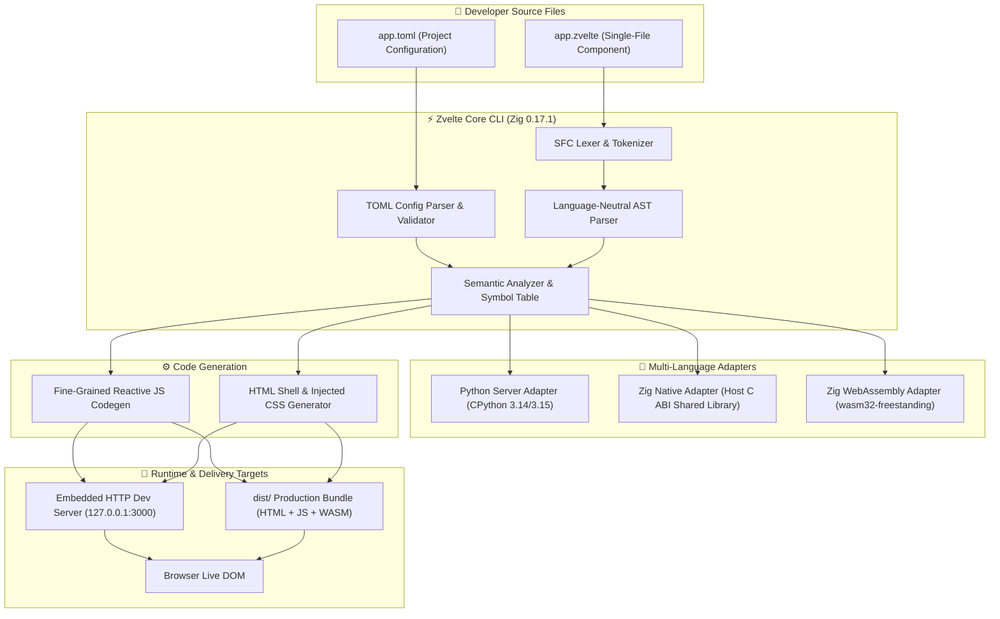
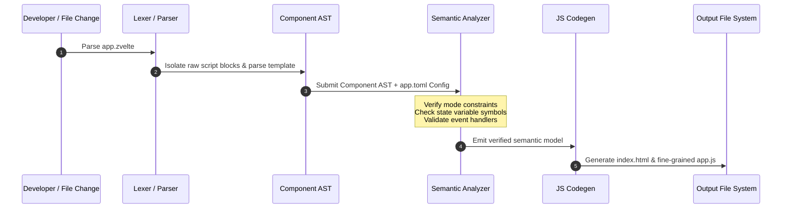
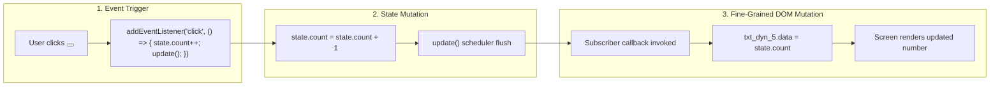
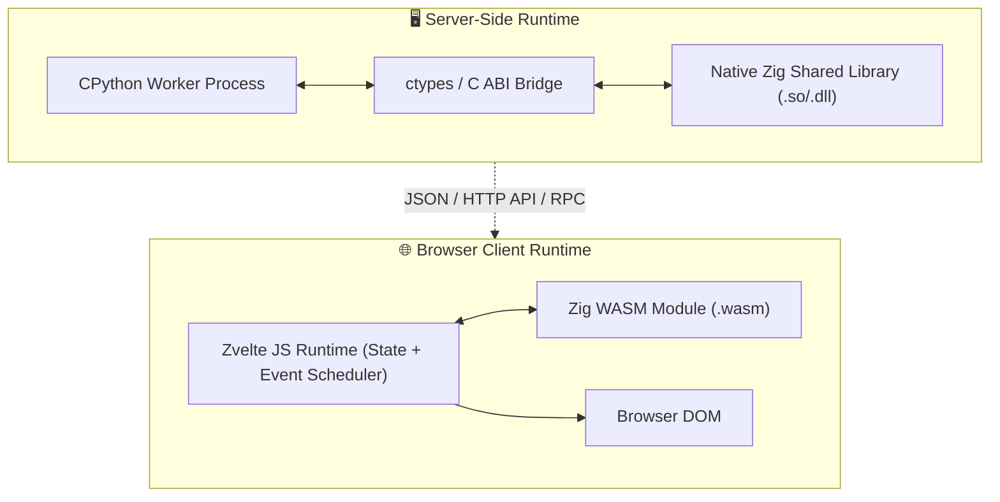

# 🏗️ Zvelte Architecture & Internal Design

> A comprehensive deep-dive into the compiler internals, component pipeline, reactivity model, and multi-language execution runtime of the Zvelte framework.

---

## 🧭 System Overview

Zvelte is structured as a unified pipeline implemented in **Zig 0.17.1**, designed around three core principles:
1. **Deterministic Simplicity:** Scaffolds strictly two user-facing files (`app.toml` and `app.zvelte`).
2. **Fine-Grained DOM Updates:** Eliminates Virtual DOM reconciliation; reactive state mutations directly target and mutate affected DOM text cells and attributes.
3. **Multi-Language Hybrid Execution:** Coordinates Python server-side logic, Zig native compute routines, and browser JavaScript/WASM execution within one component syntax.



---

## 🧩 1. The Single-File Component (`.zvelte`) Pipeline

A `.zvelte` file consolidates server logic, native acceleration, client reactive state, markup, and styles without syntax ambiguity.

### Grammar Segmentation
The parser treats the file as distinct raw language regions:

| Region | Syntax Boundary | Parser Action | Destination |
|---|---|---|---|
| Python Server Code | `<script lang="python" context="server">` | Raw extraction up to `</script>` | Python Server Supervisor / Bridge |
| Zig Native Code | `<script lang="zig" context="native">` | Raw extraction up to `</script>` | C-ABI Native Shared Library |
| Zig WASM Code | `<script lang="zig" context="wasm">` | Raw extraction up to `</script>` | `wasm32-freestanding` Compiler |
| Reactive State | `<state>` | Line-by-line typed state parser | Reactive State Store & Dependency Graph |
| Component Template | Markup elements & text | Recursive element AST parser | Direct DOM Generation Code |
| Dynamic Expressions | `{expression}` | Expression tokenizer | Text/attribute subscription bindings |
| Event Handlers | `event={expression}` | Event attribute binding parser | DOM event listener generation |
| Styles | `<style>` | Raw CSS block extraction | Injected `<style>` head element |



---

## ⚡ 2. Fine-Grained Reactive DOM Model

Traditional frontend frameworks evaluate a Virtual DOM tree on every state update, performing structural reconciliation ($O(N)$ diffing). 

Zvelte implements **Fine-Grained Surgical Updates**:
1. During compile-time, each dynamic interpolation `{count}` is registered with its specific parent DOM node.
2. The compiler generates an atomic subscriber callback:
   ```javascript
   const txt_dyn_5 = document.createTextNode(state.count);
   subscribe(() => { txt_dyn_5.data = state.count; });
   ```
3. When an event fires (e.g., `click={count++}`):
   - The state cell is mutated: `state.count++`.
   - The scheduler flushes subscribers: `update()`.
   - Only `txt_dyn_5.data` is updated.
   - **No other DOM nodes, buttons, or parent elements are touched.**



---

## 🔌 3. Multi-Language Execution Model

Zvelte provides dedicated roles for each language:



### Script Execution Roles

- **Python (`context="server"`):**
  - Runs inside CPython on the host.
  - Used for database integrations, machine learning, external APIs, and server logic.
  - Never shipped raw to the browser.
- **Zig (`context="native"`):**
  - Compiled into high-performance host machine code.
  - Directly callable from Python via C ABI bindings.
- **Zig (`context="wasm"`):**
  - Compiled targeting `wasm32-freestanding`.
  - Loaded by the browser JavaScript runtime for heavy numerical computation or cryptographics.

---

## 📁 4. The Two-File Invariant

A central guarantee of Zvelte is the **Two-File Project Scaffold**:

```text
my-app/
├── app.toml      # The single, authoritative configuration file
└── app.zvelte    # The single, authoritative source file
```

When building or developing:
- `.zvelte/` holds disposable development artifacts and temporary cache.
- `dist/` holds production HTML and JavaScript.
- Running `zvelte clean` instantly removes `.zvelte/` and `dist/`, restoring the workspace to its exact two-file state without touching user code.
