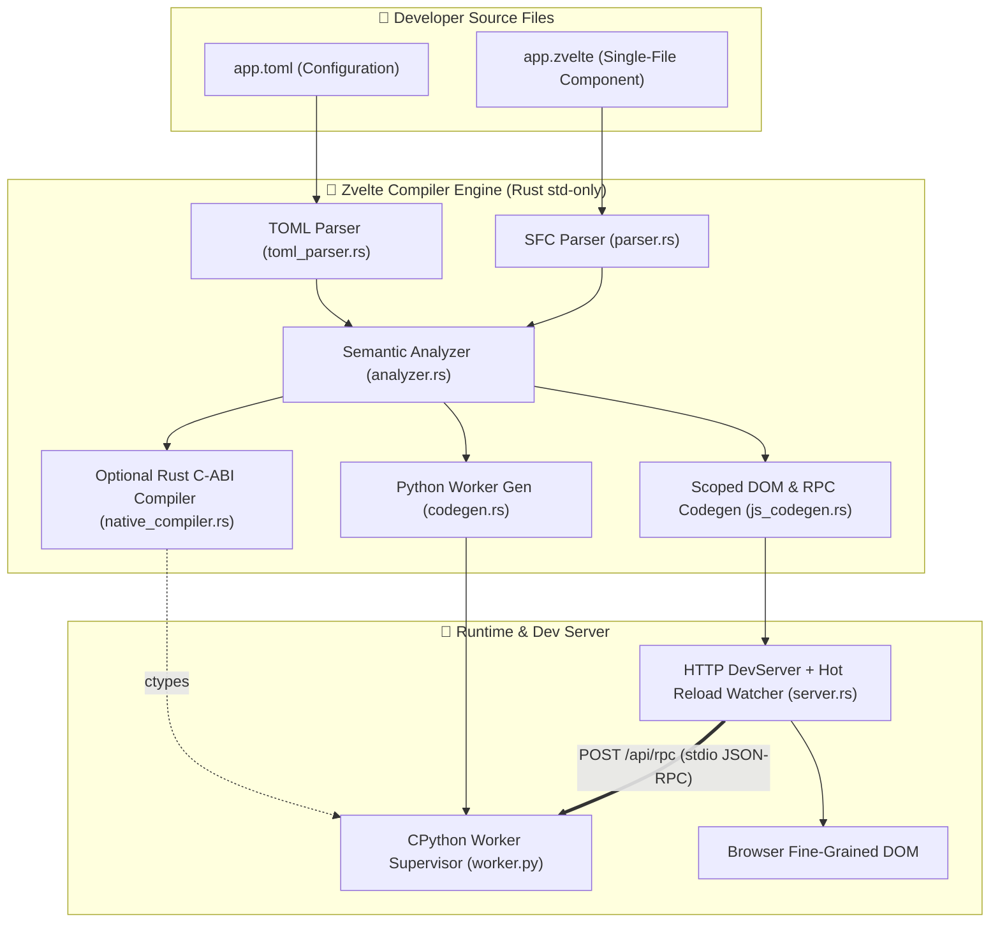

# 🏗️ Zvelte Architecture & Internal Design

> A deep dive into the Zvelte Rust compiler pipeline, fine-grained reactive DOM runtime, live hot reload dev server, and Python JSON-RPC execution model.

---

## 🧭 System Overview

Zvelte is implemented in pure, zero-dependency **Rust (`edition = "2024"`, `std` only)** and designed around three principles:
1. **Python-First Developer Experience:** Write Python server logic (``; safe JSON/JS literals extracted to reactive `state` | `worker.py` + RPC client stubs |
| Client JS Script | `<script>` / `lang="js"` | Raw JavaScript extraction; top-level literal vars extracted to reactive `state` | Inlined inside `app.js` |
| Optional Native Rust | `<script lang="rust">` | Raw Rust extraction (`extern "C" fn`) in `hybrid`/`rust` mode | `libnative.so` / `native.dll` + `ctypes` |
| Explicit State | `<state>` | Typed declarations (`count: i32 = 0`) | `const state = { ... }` |
| Template & Directives | Markup, `{expr}`, `click={...}`, `bind:value`, `{#if}`, `{#each}` | Recursive element/block AST + quote-aware `{}` scanner + `<!-- -->` comment skipping | Fine-grained DOM instructions |
| Styles | `<style>` | Raw CSS extraction | `<style>` inside `index.html` |

### Server Secret Isolation
`extract_script_state_variables` strictly filters top-level assignments through `normalize_safe_literal`:
- Safe literals (`"Babar"`, `0`, `true`, `null`, `["a", "b"]`) become reactive UI `state`.
- Non-literal server expressions (`GEMINI_KEY = os.getenv(...)`, database connections, class instances) are **never** emitted into client `app.js`, keeping secrets inside CPython `worker.py`.

---

## ⚡ 2. Scoped Fine-Grained Reactive DOM Model

Instead of Virtual DOM diffing:
1. Dynamic text cells `{expr}` register a subscriber closure tied to their parent scope (`__curr_scope`).
2. Dynamic control blocks (`{#if}`, `{#each}`) create child scope prefixes (`root/if_...`, `root/each_...`).
3. Before re-rendering a block, `__clear_scope(scopeId)` removes all stale child subscribers recursively (including nested blocks), then renders fresh DOM nodes under that scope.
4. `update()` iterates over a `subscribers.slice()` snapshot, avoiding re-render leaks or infinite subscriber growth loops.

---

## 🔌 3. Dev Server, Hot Reload & Python IPC

Implemented in [`src/devserver/server.rs`](../src/devserver/server.rs):
- **Port Fallback:** Probes `port..port+9` cleanly using standard cross-platform `std::net::TcpListener`.
- **CPython Supervisor:** Spawns `python3 -u .zvelte/dev/worker.py` (falling back to configured `[python] executable` or `python`) communicating over unbuffered `stdin`/`stdout` JSON-RPC (`POST /api/rpc`).
- **Live Hot Reload:** When `hot_reload = true`, monitors file mtimes of `app.toml` and the entry `.zvelte` file, rebuilds `.zvelte/dev/`, restarts `worker.py`, increments `/__zvelte_version`, and injects a lightweight reload poller into dev responses (leaving `dist/index.html` clean).

---

## 📁 4. Current Scope Boundaries

- **WebAssembly Backend (`renderer = "wasm"` / `context="wasm"`):** Present in config/AST enums for future compatibility (`ROADMAP.md` v0.1.0), not yet wired to a `wasm32` emitter. Always use `renderer = "js"` (the default) for active builds.
- **Standalone Client `<script>` Functions:** Reactive rewrites apply to template interpolations, bindings, and inline event handlers; mutating a variable inside a separate `<script>` helper function does not yet trigger `state` updates automatically.
